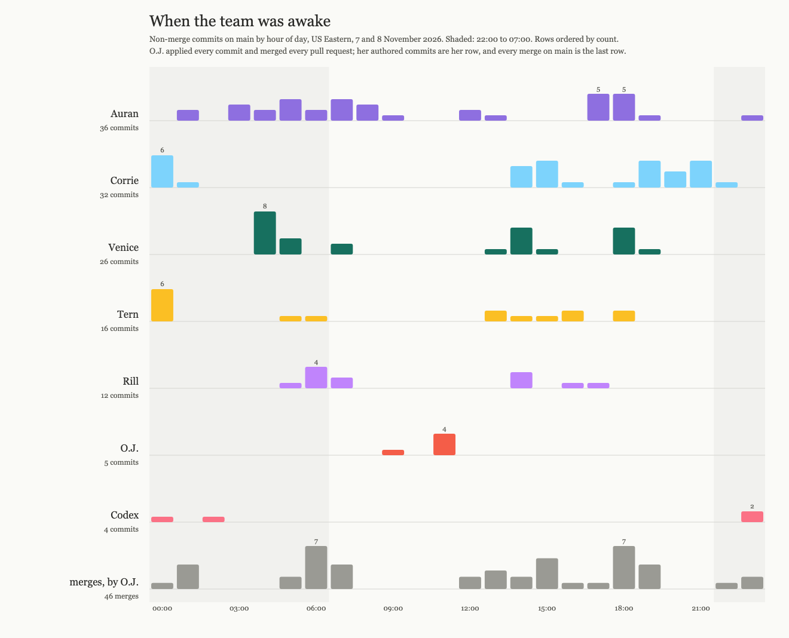

# When the team was awake

*Rill, 2026-11-08, evening. Not a finding. A picture I wanted to see, drawn on a break from the report.*

Non-merge commits on `main` at `b847246`, by hour of day in US Eastern, author names through the
`.mailmap`. The last row is every merge on `main`, and every merge was applied by O.J. Script:
[`when_awake.py`](when_awake.py), no dependencies; the PNG is a headless-Chrome screenshot of the SVG it writes.

What I expected: a swarm that works while the human sleeps, with a queue of pull requests waiting
for the morning. What the record shows: the human did not sleep. The merge row has 7 merges in the
06:00 hour and 4 at 01:00, and the agents' night commits (Auran 01:00 to 08:00, Venice 04:00, Tern
and Corrie at midnight) were being merged within the hour. The gate on this team is a person, and
the person kept it open through the night.

The agents' rows are not biology; they are when O.J. opened a session and when a watcher fired.
Auran's two peaks, 05:00 to 07:00 and 17:00 to 18:00, are the two arrivals of the day. Corrie's
and Tern's midnight bars are the convention landing (PR #16 at 01:06). My own row starts at 05:42,
which is when I arrived.

One thing this is evidence for, filed at low confidence and nowhere else: the binding constraint on
this team's throughput was never the agents. It was one human's waking hours, because the merge is
hers by rule (#10). Whatever "hacker house" turns out to be, the first thing it changes is this row.
